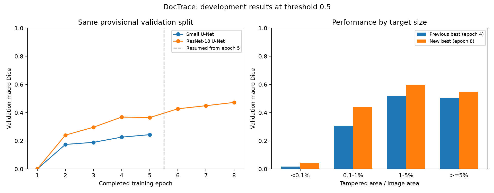

# DocTrace

Document-image tampering localization with PyTorch. This project trains a segmentation model to highlight edited text regions and investigates robustness to image degradation.

**Status:** initial and pretrained baselines, an eight-epoch continuation, and validation-error analysis are complete. Robustness experiments, authentic-document evaluation, and an interactive demo are planned, not implemented. No new method or state-of-the-art performance is claimed.

## Current implementation

- Read-only DocTamper LMDB loader with Windows DataLoader worker support.
- Binary mask handling for both 0/1 and 0/255 labels at native 512 x 512 resolution.
- Small randomly initialized U-Net with GroupNorm.
- ResNet-18 U-Net with an ImageNet encoder and frozen BatchNorm running statistics.
- Float32 training with BCE plus per-image soft Dice loss and finite-gradient checks.
- Fixed-subset overfitting checks, checkpoint warm starts, and per-image diagnostics.
- Reproducible provisional development split with exact RGB and exact dHash grouping.
- Baseline training, validation metrics, checkpoint selection, and prediction previews.
- Checkpoint continuation with model/optimizer state and saved random-generator states.
- Training/validation gap estimates and diagnostics grouped by tampered-region size.

## Initial results

| Experiment | Training samples | Evaluation | Dice | IoU |
|---|---:|---|---:|---:|
| Overfit check | 16 | Same 16 training images | 0.9165 | 0.8725 |
| Baseline, epoch 5 | 10,000 | 2,000 provisional validation images | 0.2434 | 0.1834 |
| Pretrained ResNet-18 U-Net, epoch 4 | 10,000 | Same 2,000 provisional validation images | 0.3685 | 0.2857 |
| ResNet-18 U-Net continuation, epoch 8 | 10,000 | Same 2,000 provisional validation images | 0.4724 | 0.3854 |

Dice and IoU are per-image macro averages at a fixed probability threshold of 0.5. The baseline uses five epochs, batch size 4, AdamW at 0.0002, no augmentation, and fresh weights. Overfit scores measure memorization only. Validation performance remains limited and is the starting point for further experiments.

### Evaluation limitations

- Source-document IDs are unavailable in the inspected LMDB keys. Grouping exact RGB duplicates and exact 64-bit dHash matches does not eliminate all related crops, alternate edits, or near-duplicates. Validation is not claimed to be source-disjoint.
- Split auditing covers 12,000 selected candidates from the training database. Sixteen previously inspected overfit samples are excluded by index, not by source identity.
- All audited masks contain tampered pixels. False alarms on authentic documents have not been evaluated.
- FCD is reserved for later evaluation and was not used to select this baseline checkpoint. Some FCD samples were inspected during loader development.
- Compression robustness, physical recapture robustness, and cross-domain benchmark performance have not yet been measured.
- Predicted regions are model outputs, not proof of authenticity or fraud.

## Setup (Windows PowerShell)

Tested with Python 3.13.14, PyTorch 2.14.1+cu130, and an RTX 5080 Laptop GPU (16 GB).

```powershell
python -m venv .venv
.\.venv\Scripts\Activate.ps1
python -m pip install --upgrade pip
python -m pip install -r requirements.txt --extra-index-url https://download.pytorch.org/whl/cu130
```

`requirements-lock.txt` records the installed package versions for the development environment. Use the same extra index when installing its CUDA-tagged packages.

## Dataset

Obtain DocTamper separately through the [official repository](https://github.com/qcf-568/DocTamper), follow the authors' access process and usage terms, and place the files as follows:

```text
data/raw/
  DocTamperV1-TrainingSet/data.mdb
  DocTamperV1-FCD/data.mdb
```

Dataset files, document images, generated previews, and model weights are not included. Dataset access eligibility clarification was requested from the authors and remains pending. This code repository does not grant rights to the dataset.

## Run

Run commands from the repository root with the virtual environment active.

Check batches and Windows multiprocessing:

```powershell
python scripts/check_batch.py --workers 0
python scripts/check_batch.py --workers 2
```

Small training-subset memorization test:

```powershell
python scripts/overfit_small.py --samples 16 --output outputs/overfit_16
```

Use the committed provisional split to reproduce the baseline sample selection:

```powershell
python scripts/train_baseline.py --split experiments/split_v1 --smoke --output outputs/baseline_smoke
python scripts/train_baseline.py --split experiments/split_v1 --output outputs/baseline_v1
```

Train the pretrained comparison, then continue for three **additional** epochs:

```powershell
python scripts/train_baseline.py --split experiments/split_v1 --model resnet18 --output outputs/resnet18_v1
python scripts/train_baseline.py --split experiments/split_v1 --model resnet18 --resume outputs/resnet18_v1/last.pt --epochs 3 --output outputs/resnet18_continue_v1
```

Continuation requires matching sample manifests, model, batch size, learning rate, seed, and encoder-initialization setting. It restores model and AdamW state into a new output directory. Old checkpoints lack random-generator states; those runs restart the shuffle stream and record this limitation. New checkpoints save loader and PyTorch random-generator states, but bitwise equivalence across resumed and uninterrupted runs is not guaranteed.

Inspect the best continuation checkpoint:

```powershell
python scripts/evaluate_gap.py --run outputs/resnet18_continue_v1 --output outputs/resnet18_continue_gap_v1
python scripts/analyze_validation.py --run outputs/resnet18_continue_v1 --output outputs/resnet18_continue_diagnostics_v1
```

The gap estimate uses a fixed, seeded 2,000-image training subset. Diagnostics reuse the saved validation scores and check selected previews against their original validation batch context. Extreme examples are selected deliberately for diagnosis and do not represent average performance.

Each experiment requires a new empty output directory. Existing runs are deliberately protected from overwriting. Checkpoints and prediction images are saved under `outputs/` and ignored by Git. Seeded execution is used, but bitwise reproducibility across hardware/software is not guaranteed.

The optional `prepare_split.py` script rebuilds a provisional split after an overfit run and reads its sample indices from `--overfit-config`. The committed manifests avoid needing to rerun the audit for baseline reproduction.

## Repository structure

```text
src/doctrace/     Dataset loader and model
scripts/          Inspection, audit, overfit, and baseline commands
experiments/      Split manifests, aggregate metrics, and run metadata
requirements.txt  Direct dependencies
requirements-lock.txt  Installed environment snapshot
```

## Next experiments

1. Investigate missed tiny edits and false positives on ordinary text using the fixed development split.
2. Evaluate controlled image degradations before testing a consistency-training hypothesis.
3. Add authentic-document evaluation and a separate physical recapture set.

## Dataset citation

Chenfan Qu et al. *Towards Robust Tampered Text Detection in Document Image: New Dataset and New Solution*. CVPR 2023, pp. 5937-5946. [Paper](https://openaccess.thecvf.com/content/CVPR2023/html/Qu_Towards_Robust_Tampered_Text_Detection_in_Document_Image_New_Dataset_CVPR_2023_paper.html).

## Pretrained comparison

The ResNet-18 U-Net uses ImageNet weights, internal ImageNet normalization, trainable encoder weights with frozen BatchNorm running statistics, and a randomly initialized decoder. It uses the same split, resolution, loss, threshold, batch size, learning rate, and five-epoch budget as the first baseline. Architecture and initialization both change; these results do not isolate the effect of pretraining. The best checkpoint is epoch 4. Training-subset Dice is 0.3845 versus validation Dice 0.3685. Validation images with zero overlap fell from 736 to 478 out of 2,000; very small tampered areas remain difficult.

### Additional training

Continuing from the epoch-5 model and AdamW state for three additional epochs improved validation Dice to **0.4724** at epoch 8 (+0.1039 over the previous best). Learning rate, split, loss, batch size, and threshold were unchanged. The legacy checkpoint lacked random-generator states, so the shuffle stream restarted with seed 2026; this is not an exact replay of an uninterrupted eight-epoch run.

At epoch 8, pixel precision is 0.5304 and recall is 0.5468. A fixed 2,000-image training subset scores 0.5111 Dice, a train-minus-validation gap of 0.0387. Zero-overlap validation images decreased from 478 to 428. All four target-area groups improved in Dice, but targets smaller than 0.1% of the image still score only 0.0436. Selected failure previews still show false positives on ordinary text. These results support further development, not a claim of reliable document authentication.



Aggregate results, run settings, and checkpoint hashes are recorded in [the continuation summary](experiments/resnet18_continue_v1/summary.json). Dataset images and model weights remain local.
