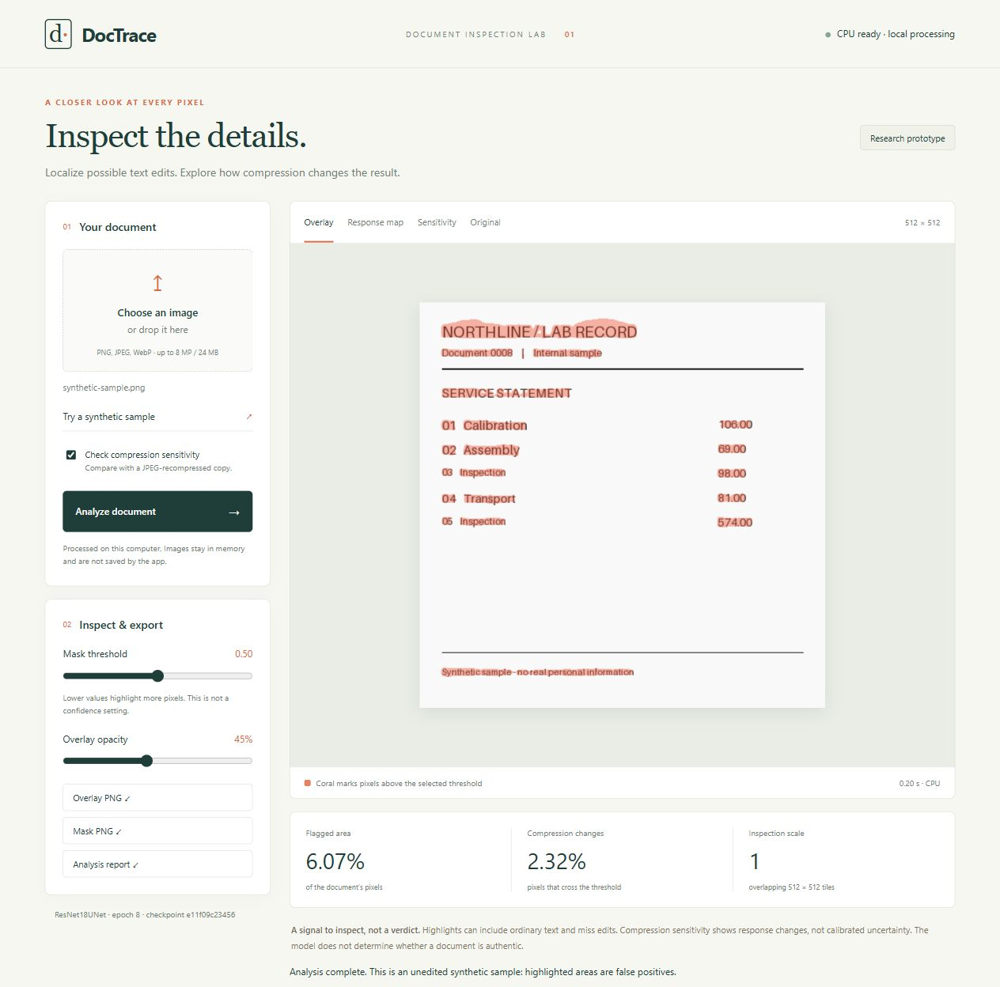
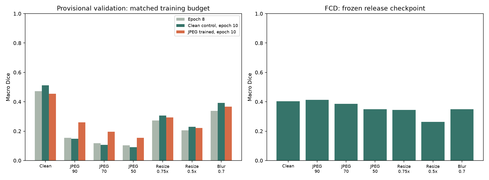

# DocTrace

**Document-image tampering localization, with a closer look at robustness.**

DocTrace is a local computer-vision research prototype that highlights possible edited text regions and shows how its predictions change after JPEG recompression. It combines PyTorch segmentation, a controlled robustness experiment, native-scale tiled inference, and a browser interface for inspecting and exporting results.

**Version 1 scope:** a working local demo, reproducible training/evaluation tools, a matched JPEG-augmentation comparison, separate FCD evaluation, and explicit failure analysis. It is not a document-authenticity verifier. No novel architecture, state-of-the-art result, or calibrated fraud probability is claimed.



*Interface verification using the epoch-8 model and an unedited procedural sample. Highlights here are false positives, not successful tampering detections. The release model is selected separately by the protocol below.*

## What it does

- **Localize:** ResNet-18 encoder with a U-Net decoder predicts a per-pixel response at native resolution.
- **Inspect full images:** overlapping 512 × 512 tiles with raised-cosine weighted blending preserve small text instead of shrinking every page to one square. This full-page mode is a deployment extension, not the benchmark protocol.
- **Probe sensitivity:** multi-condition probe (jpeg90, jpeg70, jpeg50, blur07) evaluates per-condition and worst-case sensitivity. Distinguishes genuine threshold flips from large absolute response changes (cutoff 0.10). These are empirical stability measures, not calibrated certainty scores.
- **Error Level Analysis:** ELA re-saves the image at JPEG quality 90 (4:2:0 subsampling) and computes the amplified absolute difference (×15, clipped to [0, 255]) — a classical forensic inspection tool. Unedited text naturally produces high residuals; ELA does not prove tampering.
- **Region summary:** single-pass connected-component aggregation ranks suspicious areas by pixel area, reporting bounding box [y_min, x_min, y_max, x_max], area fraction, and mean model response. Bounding boxes are interactive in the web interface.
- **Explore:** overlay, response-map, sensitivity, worst-case, ELA, and original views; adjustable threshold and opacity sliders.
- **Export:** overlay PNG, binary mask PNG, raw ELA residual PNG, colorized rendered ELA PNG, worst-case sensitivity PNG, JPEG-70 sensitivity PNG, and a schema v3 JSON report clearly separating immutable server analysis (at 0.50) from interactive client inspection. The CLI additionally exports full-precision probability arrays (`probabilities.npy`).
- **Keep processing local:** no external inference service, browser uploads to third parties, or server-side image persistence. The server binds to loopback only.

## Research additions

Three forensics-oriented additions run at inference time without retraining:

### 1 · Error Level Analysis (ELA)
`src/doctrace/degradations.py` (`ela`): re-saves the input as JPEG at fixed quality 90 with standard 4:2:0 chroma subsampling and returns the amplified per-pixel absolute residual (amplification ×15, clipped to [0, 255]). ELA is an inspection heuristic: ordinary unedited high-contrast text naturally produces high residuals, and compression artifacts vary with resolution, crop, and file formats (PNG/WebP). The web interface allows downloading both the raw amplified residual (`ela-residual.png`) and the colorized inspection view (`ela-rendered.png`). The CLI exports `ela_residual.png` (and `ela.png`).

### 2 · Multi-condition sensitivity probe
`src/doctrace/inference.py` (`PROBE_CONDITIONS`): the sensitivity analysis tests four conditions: **jpeg90, jpeg70, jpeg50, and blur07**. A composite **worst-case map** measures the maximum per-pixel absolute change across all four conditions. DocTrace rigorously separates two distinct stability metrics:
- **`worst_case_threshold_flip_fraction`**: fraction of pixels whose thresholded binary decision flips under any probe condition.
- **`worst_case_large_response_change_fraction`**: fraction of pixels whose absolute response shift reaches or exceeds 0.10 (an absolute change of 0.10 on the [0, 1] scale, not a relative percentage).
The browser provides downloads for both worst-case and JPEG-70 sensitivity maps. The CLI exports `sensitivity_worst_case.png` alongside `sensitivity.png`.

### 3 · Suspicious-region summary
`src/doctrace/regions.py` (`summarize_regions`): labels 4-connected components and aggregates pixel statistics in a single vectorized pass ($O(N)$ with respect to image pixels, avoiding $O(N \cdot K)$ full-image rescans). Components are deterministically sorted by area (descending) with tie-breaking on mean model response (descending), followed by inclusive bounding box coordinates `[y_min, x_min, y_max, x_max]`. The top $K$ regions (default 10) are returned, and `total_regions_count`, `returned_regions_count`, and `regions_truncated` are reported. In the web interface, clicking any region in the sidebar highlights its bounding box on the image canvas.

## Run the demo

For the existing development checkout, the trained release is stored locally at `outputs/release_v1/model.pt`:

```powershell
cd D:\DocTrace
.\launch_demo.ps1
```

Open **http://127.0.0.1:8765** after the terminal says the model is ready. Stop it with Ctrl+C. The launcher uses the project's local runtime when present, otherwise the virtual environment or `python`. If that port is occupied, use `-Port 8766`.

With an activated Python environment:

```powershell
python scripts/serve.py --checkpoint outputs/release_v1/model.pt
```

Choose one PNG, JPEG, or WebP image (up to 8 megapixels, 8192 pixels per side, 24 MB, and 64 tiles). PDFs and animated images are not supported. The built-in synthetic sample is unedited and is intended to demonstrate the controls and expose false positives.

The app's display and interactive exports use 8-bit probability maps; rounding error is at most 0.5/255. Scientific metrics and CLI exports use full precision. Changing the display threshold does not change reported benchmark results, which always use 0.5.

## Command-line analysis

```powershell
python scripts/predict.py path_to_image.png --output outputs/my_document
```

This writes `overlay.png`, `mask.png`, `ela_residual.png` (and `ela.png`), `sensitivity_worst_case.png` (and `sensitivity.png`), `probabilities.npy`, and `report.json`. Use `--threshold` to specify an analysis threshold (default 0.50), `--no-probe` for a single-pass inference without sensitivity probes, or `--device cpu` to run without CUDA. Output directories must be new or empty; existing results are protected.

## Evaluation and findings

The original randomly initialized U-Net reached 0.2434 validation macro Dice. An ImageNet-initialized ResNet-18 U-Net reached 0.4724 at epoch 8. Recompressing those same images at JPEG quality 90 reduced Dice to 0.1544, motivating a matched training experiment instead of assuming that clean-image performance transfers to processed documents.

The final comparison starts two models from the same epoch-8 checkpoint, trains each for two more epochs, and changes only training-time JPEG augmentation. The release is selected using the equal-weight mean of clean, JPEG 90, JPEG 70, and JPEG 50 development Dice. All clean-image tradeoffs are reported. FCD is evaluated after selection and is not used to choose the model.

**[Full results and comparison table](experiments/release_v1/RESULTS.md)** · **[Frozen selection](experiments/release_v1/selection.json)** · **[Experiment protocol](docs/EXPERIMENT_PROTOCOL.md)** · **[Model card](docs/MODEL_CARD.md)**



Dice and IoU are per-image macro averages. Precision and recall aggregate pixel counts. All scientific comparisons use threshold 0.5. False-positive fractions on synthetic negative documents are reported separately; Dice is not used to score those empty masks.

### Limits that matter

- The 10,000/2,000 development split groups exact RGB and exact 64-bit dHash matches. Source-document IDs are unavailable; related crops, alternate edits, and near-duplicates may still cross the split. It is **not guaranteed source-disjoint**.
- Only 12,000 selected candidates were audited. The 16 earlier overfit samples are excluded by index, not source identity. The 0.9165 overfit score measures memorization only.
- Some FCD images were inspected during loader development. Final FCD evaluation is separate from selection, but not a pristine blind test, and no source-separation claim is made.
- Tiny edits, border regions, and ordinary printed text cause failures. A highlighted region is not proof of fraud; an empty mask is not proof of authenticity.
- Synthetic unedited documents are a sanity check, not a substitute for real authentic-document testing. Physical recapture, AIGC edits, and document-level decisions are unvalidated.
- Results are single-seed experiments. Improvements cannot be assumed to hold across all random seeds, document types, or acquisition conditions.

## Setup and data

Tested locally on Windows, Python 3.13.14, PyTorch 2.14.1+cu130, torchvision 0.29.1+cu130, and an RTX 5080 Laptop GPU (16 GB).

```powershell
python -m venv .venv
.\.venv\Scripts\Activate.ps1
python -m pip install --upgrade pip
python -m pip install -r requirements.txt --extra-index-url https://download.pytorch.org/whl/cu130
```

`requirements-lock.txt` records the development environment. The optional `.runtime/` directory is machine-local and is not part of the repository. The web app uses Python's standard HTTP server and plain HTML/CSS/JavaScript, so it needs no frontend build step or additional web framework.

Obtain DocTamper through the [official repository](https://github.com/qcf-568/DocTamper), follow the authors' access process and usage terms, then place its LMDB files here:

```text
data/raw/DocTamperV1-TrainingSet/data.mdb
data/raw/DocTamperV1-FCD/data.mdb
```

Dataset access eligibility clarification was requested from the authors and remains pending. This repository does not grant dataset rights. Dataset images, original-document previews, checkpoints, runtime binaries, and caches are excluded from Git. Only code, aggregate metrics, manifests, charts, and screenshots of procedurally generated samples are published. A fresh clone therefore needs authorized data and locally trained weights before the demo can perform inference.

## Reproduce the experiment

Run from the repository root. The committed split manifests preserve the original sample selection:

```powershell
python scripts/check_batch.py --workers 2
python scripts/train_baseline.py --split experiments/split_v1 --model resnet18 --output outputs/resnet18_v1
python scripts/train_baseline.py --split experiments/split_v1 --model resnet18 --resume outputs/resnet18_v1/last.pt --epochs 3 --output outputs/resnet18_continue_v1
python scripts/train_baseline.py --split experiments/split_v1 --model resnet18 --resume outputs/resnet18_continue_v1/last.pt --epochs 2 --output outputs/clean_control_v1
python scripts/train_baseline.py --split experiments/split_v1 --model resnet18 --resume outputs/resnet18_continue_v1/last.pt --epochs 2 --augmentation jpeg --output outputs/jpeg_adapt_v1
python scripts/finalize_release.py
```

`finalize_release.py` evaluates seven perturbation conditions, saves the frozen selection, evaluates FCD and synthetic negatives, exports inference-only weights, and writes the aggregate report. It reuses complete reports only when checkpoint hashes and suite definitions match. Existing partial output folders are preserved; investigate an interrupted run before restarting it.

The historical epoch-5 checkpoint lacked RNG state, so the original continuation restarted its shuffle stream. New checkpoints save PyTorch and loader generator states; worker augmentation RNG states are not saved. Seeded execution does not guarantee bitwise reproducibility across restarts, hardware, or software. Recorded checkpoint hashes identify the actual evaluated models.

Additional diagnostics:

```powershell
python scripts/evaluate_gap.py --run outputs/resnet18_continue_v1 --output outputs/gap_new
python scripts/analyze_validation.py --run outputs/resnet18_continue_v1 --output outputs/diagnostics_new
python -m unittest discover -s tests -v
```

The tests run on CPU without the dataset or trained weights. They cover decoding, EXIF orientation, transparency, tiling geometry, perturbation determinism, mask preservation, and local-server boundaries. Browser checks additionally covered sample inference, threshold changes, sensitivity view, JSON export, desktop/mobile layouts, and console errors.

## Project structure

```text
src/doctrace/     Models, LMDB loader, augmentations, inference, procedural samples
scripts/          Training, evaluation, export, CLI prediction, local server
web/              Browser interface with no build step
tests/            Dataset-free CPU tests
experiments/      Split manifests, aggregate metrics, provenance, charts
docs/             Protocol, model card, demo screenshots, portfolio notes
outputs/          Local checkpoints and detailed results (Git-ignored)
```

## Contribution and future work

The contribution is an end-to-end investigation of a concrete failure mode: clean-image localization can deteriorate under recompression, and a controlled augmentation comparison measures whether it helps. The demo exposes this sensitivity instead of presenting model response as certainty. The components themselves are established techniques; experimental discipline and transparent deployment are the project's differentiators.

Future research includes real authentic-document evaluation, source-aware splits, physical print/scan/camera capture, tiny-edit recall, additional seeds, and frequency-domain or consistency-training ablations. These are extensions beyond the delivered v1 prototype.

## Dataset citation

Chenfan Qu et al. *Towards Robust Tampered Text Detection in Document Image: New Dataset and New Solution*. CVPR 2023, pp. 5937–5946. [Paper](https://openaccess.thecvf.com/content/CVPR2023/html/Qu_Towards_Robust_Tampered_Text_Detection_in_Document_Image_New_Dataset_CVPR_2023_paper.html).
