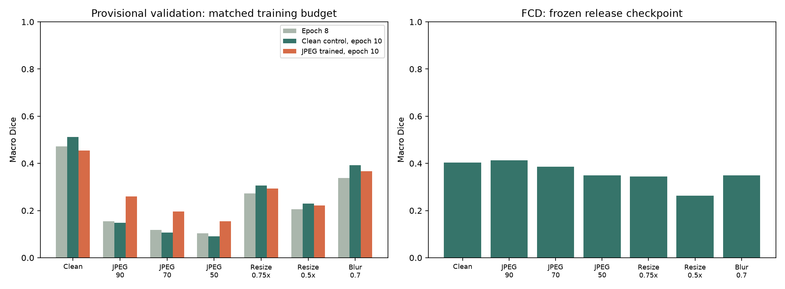

# Release evaluation

Threshold 0.5. Per-image macro Dice; 2,000 images per dataset. The development split is provisional and not guaranteed source-disjoint.

| Condition | Epoch 8 | Clean control | JPEG trained | FCD release |
|---|---:|---:|---:|---:|
| clean | 0.4724 | 0.5121 | 0.4545 | 0.4029 |
| jpeg90 | 0.1544 | 0.1483 | 0.2594 | 0.4125 |
| jpeg70 | 0.1184 | 0.1074 | 0.1953 | 0.3852 |
| jpeg50 | 0.1031 | 0.0904 | 0.1540 | 0.3486 |
| resize75 | 0.2721 | 0.3055 | 0.2940 | 0.3448 |
| resize50 | 0.2061 | 0.2294 | 0.2221 | 0.2635 |
| blur07 | 0.3382 | 0.3930 | 0.3665 | 0.3495 |

Selected checkpoint: **jpeg_augmented**, epoch 10. Selection score: **0.2658** (equal mean of clean and three JPEG conditions).

## Synthetic clean-document check

These 64 procedural images contain no tampering; they do not represent real authentic documents.

| Condition | Mean false-positive pixel fraction | Documents with >=0.1% flagged area |
|---|---:|---:|
| clean | 2.54% | 64/64 |
| jpeg70 | 2.56% | 64/64 |

Compression, resizing, and synthetic blur do not simulate all physical capture effects. No real authentic-document accuracy or calibrated fraud probability is claimed.

